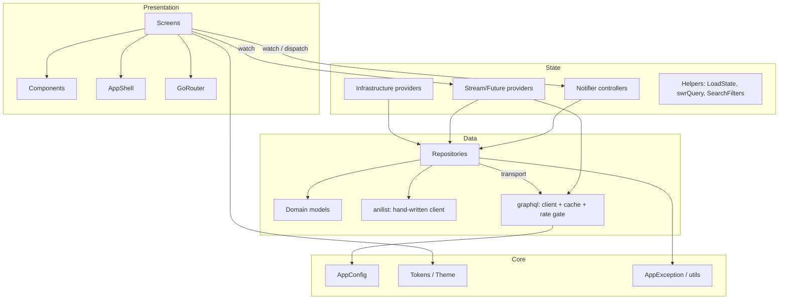
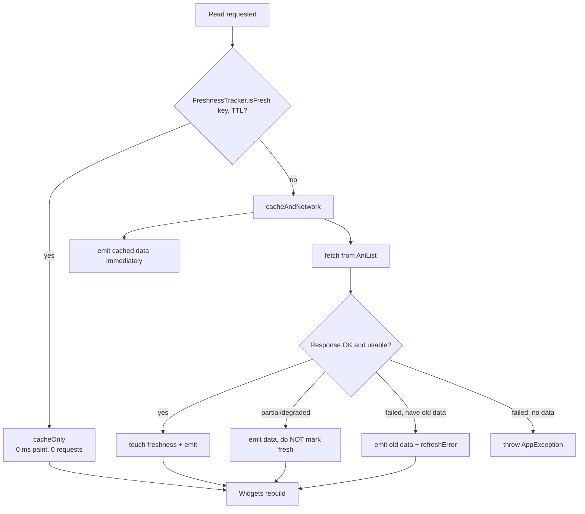
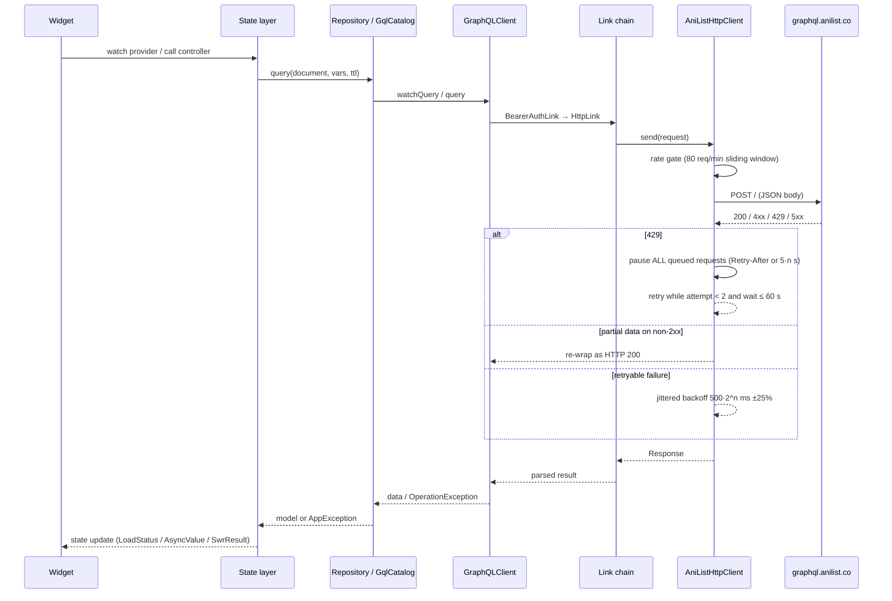

# Architecture

How Ikigai is structured, how data moves through it, and which layers are allowed to
depend on which.

## Contents

- [High-level view](#high-level-view)
- [Layers](#layers)
- [Folder and file responsibilities](#folder-and-file-responsibilities)
- [Dependency rules](#dependency-rules)
- [Data flow](#data-flow)
- [Navigation and routing](#navigation-and-routing)
- [Startup sequence](#startup-sequence)
- [Diagrams](#diagrams)

---

## High-level view

Ikigai is a **single-page Flutter Web application** with no backend of its own. Every
byte of remote data comes from AniList's public GraphQL endpoint. All durable state
lives in the browser.

```
┌──────────────────────────────────────────────────────────────────────┐
│  Browser                                                            │
│                                                                      │
│  ┌────────────────────────────────────────────────────────────────┐  │
│  │ ui/            Presentation                                    │  │
│  │   screens → components → layout(AppShell) → router(GoRouter)   │  │
│  └───────────────▲──────────────────────────────▲─────────────────┘  │
│                  │ watch / read                 │ dispatch actions   │
│  ┌───────────────┴──────────────────────────────┴─────────────────┐  │
│  │ state/         Application state (Riverpod)                    │  │
│  │   Notifier controllers · providers · SWR helpers               │  │
│  └───────────────▲──────────────────────────────────▲─────────────┘  │
│                  │ repositories                     │ providers      │
│  ┌───────────────┴──────────────────────────────────┴─────────────┐  │
│  │ data/          Data                                            │  │
│  │   repositories → models · anilist(client/queries) · graphql     │  │
│  └───────▲───────────────────────────────────────▲────────────────┘  │
│          │ read/write                           │ query/mutate       │
│  ┌───────┴───────────────┐          ┌───────────┴─────────────────┐  │
│  │ localStorage          │          │ IndexedDB (Hive)            │  │
│  │ shared_preferences    │          │ GraphQL cache + freshness   │  │
│  └───────────────────────┘          └───────────▲─────────────────┘  │
│                                                 │                    │
│  ┌──────────────────────────────────────────────┴─────────────────┐  │
│  │ core/          Cross-cutting                                   │  │
│  │   AppConfig · Tokens/Theme · AppException · formatters/utils   │  │
│  └────────────────────────────────────────────────────────────────┘  │
└──────────────────────────────────────────────────────────────────────┘
                                  │  HTTPS (POST, single endpoint)
                                  ▼
                     https://graphql.anilist.co
```

---

## Layers

Four layers, each with a single responsibility and a one-directional dependency
flow: **UI → State → Data → Core**.

### 1. Presentation — `lib/ui/`

**Responsibility:** render state and translate user gestures into state changes. It
holds **no** business rules and performs **no** I/O.

| Subfolder | Responsibility |
| --- | --- |
| `screens/` (13) | One file per screen or dialog. Compose components, watch providers, dispatch controller methods. (One file — `filters_sheet.dart` — is dead code; see [FEATURES.md](FEATURES.md).) |
| `components/` (23) | Reusable, mostly stateless widgets. Some read a provider directly (`ThemeSwitch`, `AccountButton`), none owns business logic. |
| `layout/` | `AppShell` — sidebar/bottom nav, top bar, keyboard shortcuts, aurora background, page transition, global snackbar listener. |
| `router/` | `GoRouter` configuration and the `Routes` constants. |

Screens may `ref.watch` / `ref.read` / `ref.invalidate` providers and call controller
methods. They must not construct repositories or touch `http`/`SharedPreferences`.

### 2. State — `lib/state/`

**Responsibility:** hold application state, coordinate async work, and expose a
clean API to the UI. This is the only layer that knows about *both* the UI's
expectations and the data layer's capabilities.

- **Notifier controllers** own multi-step, user-driven flows with side effects:
  `BrowseController`, `CalendarController`, `SearchController`, `MyListsController`,
  `HistoryController`, `SettingsController`, `OptimisticEntries`.
- **Stream/Future providers** expose read-only data with async semantics:
  `mediaRailProvider`, `mediaDetailProvider`, `notificationsProvider`, …
- **Infrastructure providers** wire singletons: `sharedPreferencesProvider`,
  `gqlStorageProvider`, `graphQLClientProvider`, `mediaRepositoryProvider`.
- **Helpers** define shared vocabulary without holding state: `LoadState`/`LoadStatus`,
  `SwrResult`/`swrQuery`, `SearchFilters`.

State never imports `ui/`. It may import `data/` and `core/`.

### 3. Data — `lib/data/`

**Responsibility:** persistence and network. It returns **models**, never widgets or
user-facing strings, and it never formats an error message for display.

| Subfolder | Responsibility |
| --- | --- |
| `repositories/` | The public data API. `AuthRepository`, `MediaRepository`, `TrackingRepository`, `HistoryRepository`. Caching, in-flight dedupe, and business rules live here. |
| `models/` | Plain-Dart domain models with hand-written JSON. This is the vocabulary the rest of the app speaks (`Media`, `MediaEntry`, `HistoryEntry`, `ViewerProfile`, …). |
| `anilist/` | The **hand-written** HTTP client (`AniListClient`), raw query document strings (`anilist_queries.dart`), and the defensive JSON mapper (`anilist_mapper.dart`). |
| `graphql/` | The **graphql_flutter** stack: `GraphQLClient` bootstrap, Hive cache, `BearerAuthLink`, the rate-limited `AniListHttpClient`, parsed `DocumentNode`s, and freezed GraphQL models. |

Data may import `core/`. It must not import `state/` or `ui/`.

> **Two HTTP paths coexist by design.** `graphql/` is the production path used by
> everything reachable from `gqlCatalogProvider`. `anilist/AniListClient` remains as
> the auth-path client and as `MediaRepository`'s fallback when no transport is
> injected. Both map failures into the same `AppException` taxonomy, so the UI cannot
> tell them apart — and does not need to.

### 4. Core — `lib/core/`

**Responsibility:** cross-cutting primitives with no dependencies on any other layer.

| Subfolder | Responsibility |
| --- | --- |
| `config/` | `AppConfig` — endpoint, OAuth client id, login URIs, environment defines. |
| `theme/` | `Tokens` (design tokens), `app_theme.dart` (light/dark `ThemeData`), `app_motion.dart`, scroll physics, `responsive.dart`. |
| `utils/` | `AppException`/`ErrorKind`, `Formatters`, `Debouncer`, `safeExternalUri`, `clearUrlFragment` (web/stub conditional export). |

Everything may import `core/`. `core/` imports nothing from `ui/`, `state/`, or `data/`.

---

## Folder and file responsibilities

```
lib/
├── main.dart                     Entry point. Ordered startup: error hooks → path URL
│                                 strategy → prefs (with mock fallback) → GraphQL storage
│                                 → OAuth fragment capture → runApp(ProviderScope).
├── app.dart                      IkigaiApp: watches router, themeMode, accent; builds
│                                 MaterialApp.router with light/dark themes.
│
├── core/
│   ├── config/app_config.dart    aniListEndpoint, OAuth authorize endpoint,
│   │                             anilistClientId (dart-define with fallback),
│   │                             hasAnilistClient, anilistLoginUri().
│   ├── theme/
│   │   ├── design_tokens.dart    class Tokens — palette, surfaces, status hues, accents,
│   │   │                         breakpoints, spacing, radii, glowShadow().
│   │   ├── app_theme.dart        Light and dark ThemeData built from Tokens.
│   │   ├── app_motion.dart       Durations and curves (toggle 220, press 120, reveal 380,
│   │   │                         shimmer 1300 ms).
│   │   ├── responsive.dart       Width breakpoints and layout helpers.
│   │   ├── app_scroll.dart       SmoothScrollPhysics (clamped).
│   │   └── bouncy_scroll.dart    Bouncy variant.
│   └── utils/
│       ├── app_exception.dart    AppException + ErrorKind + userMessage mapping.
│       ├── debouncer.dart        Debouncer (default 400 ms).
│       ├── external_link.dart    safeExternalUri — http/https only.
│       ├── formatters.dart       clockTime, date, timeUntil, score, timeAgo, compactNumber…
│       └── url_cleaner*.dart     clearUrlFragment() — web impl + no-op stub.
│
├── data/
│   ├── anilist/
│   │   ├── anilist_client.dart   Hand-written client: retry, backoff, 429 handling,
│   │   │                         partial-data pass-through, status classification.
│   │   ├── anilist_queries.dart  Raw GraphQL document strings + shared selections.
│   │   └── anilist_mapper.dart   Defensive JSON → model mapping (677 lines).
│   ├── graphql/
│   │   ├── graphql_bootstrap.dart  buildGraphQLClient(), openGqlStorage(), FreshnessTracker,
│   │   │                           box names kGqlBox / kMetaBox.
│   │   ├── anilist_http_client.dart  Sliding-window rate gate, 429 pause, retries, timeout.
│   │   ├── bearer_auth_link.dart  Per-request Bearer token injection (null ⇒ no header).
│   │   ├── anilist_documents.dart Parsed DocumentNodes + the shared MediaCard fragment.
│   │   └── models/               freezed: AnimeMedia, MediaListEntry + converters.
│   ├── models/                   Domain models (hand-written JSON, no codegen).
│   └── repositories/
│       ├── auth_repository.dart    OAuth implicit grant, Viewer validation, session restore.
│       ├── media_repository.dart   Browse/detail/schedule/search/people/profile queries,
│       │                           5-min LRU cache, in-flight dedupe, optional transport.
│       ├── tracking_repository.dart  LocalTrackingRepository — the user's list, locally.
│       └── history_repository.dart   LocalHistoryRepository — last 50 opened titles.
│
├── state/                        16 files, 41 providers (see STATE_MANAGEMENT.md)
│   ├── providers.dart            prefs, tracking repo, auth repo, authStateProvider.
│   ├── graphql_providers.dart    gqlStorage, graphQLClient, toAppError, noProviderRetry.
│   ├── gql_catalog.dart          GqlCatalog — one-shot SWR reads + the raw transport.
│   ├── anime_providers.dart      animePage/animeById/trackedEntry SWR streams.
│   ├── media_providers.dart      rails, detail, people works, profile, lists, activity.
│   ├── *_controller.dart         Notifier controllers for each user-driven flow.
│   ├── tracked_entries_notifier.dart  Optimistic overlay + debounced AniList sync.
│   ├── load_state.dart           LoadStatus + LoadState<T>.
│   ├── swr.dart                  SwrResult<T> + swrQuery() stale-while-revalidate.
│   └── search_filters.dart       Immutable SearchFilters value type.
│
└── ui/
    ├── router/app_router.dart    Route table, Routes constants, errorBuilder 404.
    ├── layout/app_shell.dart     Nav shell, top bar, shortcuts, snackbar host.
    ├── components/               23 reusable widgets (see FEATURES.md for the big ones).
    └── screens/                  13 screen files (see FEATURES.md).
```

**Generated files** (`*.g.dart`, `*.freezed.dart`) are git-ignored and produced by
`build_runner`. They sit next to their sources and are not listed above.

---

## Dependency rules

Enforced by convention and by layering — there is no import-linter configured.

```
ui  ──▶  state  ──▶  data  ──▶  core
  ╲                   │          ▲
   ╲───────────────────┴──────────╯   (ui may use core directly)
```

| Rule | Rationale |
| --- | --- |
| `core/` imports no other app layer | Primitives must be usable from anywhere without creating cycles. |
| `data/` never imports `state/` or `ui/` | The data layer must be testable and reusable without a UI or a provider container. |
| `state/` never imports `ui/` | State changes must not be coupled to widget types; this is what lets a controller be unit-tested. |
| `ui/` never constructs a repository or an HTTP client | All I/O enters through providers, so startup overrides work. |
| Only `main.dart` calls `ProviderScope(overrides: …)` | One place decides how infrastructure is bound. |
| Errors cross layers as `AppException`, not `String` | `ErrorKind` carries semantics; only the presentation layer turns it into user copy via `userMessage`. |
| Models cross layers as `Media`/`MediaEntry`/… | The GraphQL freezed types are an implementation detail of `data/graphql`, bridged by `AnimeMedia.toMedia()`. |

**Known exception:** `MediaRepository` exposes a `transport` seam that is injected with
`GqlCatalog.raw` from the state layer. This inverts an otherwise Data → State
dependency into a constructor parameter, which keeps `data/` free of `state/` imports.

---

## Data flow

### Read (stale-while-revalidate)

```
User opens /search
        │
        ▼
SearchController._fetchInto()
        │  debounced 400 ms, monotonic request id
        ▼
GqlCatalog.browse(vars)  ──or──  swrQuery(document, operation, vars, ttl)
        │
        ├─ FreshnessTracker.isFresh(key, ttl)?
        │      yes → FetchPolicy.cacheOnly      ← 0 ms paint, zero requests
        │      no  → FetchPolicy.cacheAndNetwork ← cache emission, then network
        ▼
GraphQLClient ── Link chain: BearerAuthLink → HttpLink(AniListHttpClient)
        │                                              │
        │                                              ├─ sliding-window rate gate (80/min)
        │                                              ├─ 429 → global pause → retry
        │                                              ├─ 5xx / network → jittered backoff
        │                                              └─ partial data → treated as 200
        ▼
GraphQLCache(HiveStore → IndexedDB)          freshness.touch(key)
        │
        ▼
parse → model (freezed) → bridge to domain model (AnimeMedia.toMedia())
        │
        ▼
LoadStatus.success + items  →  widgets rebuild via select()/watch
```

**Two read shapes exist:**
1. **Streaming SWR** (`swrQuery`) — used where the UI wants a live view: home rails,
   media detail, the signed-in user's list entry. Emits cache first, then network.
2. **One-shot SWR** (`GqlCatalog._fetch`) — used by controllers that own their own
   loading state: browse, calendar, search people tabs, profile lists.

### Write (optimistic overlay)

```
User taps "+1" on progress
        │
        ▼
OptimisticEntries.incrementProgress(mediaId, totalUnits)
        │  refuses if the server entry has not loaded (never build on a guess)
        │  refuses if signed out
        ▼
overlay[mediaId] = pending entry        ← displayEntryProvider shows this immediately
        │
        ▼  debounced 500 ms (ten taps → one request)
_flush(mediaId)
        │  if a flush is already in flight → re-schedule (coalescing)
        ▼
SaveMediaListEntry(mediaId, status, progress, scoreRaw)   ← ABSOLUTE values, not +1
        │
        ├─ success → drop overlay only if state[mediaId] still equals what was sent
        │            if it was a new entry → forget freshness + invalidate provider
        └─ failure → roll back (delete overlay) + report to entrySyncErrorProvider
                                                    │
                                                    ▼
                              AppShell listener → snackbar
```

Rollback is simply "delete the overlay entry" — there is no snapshot bookkeeping,
because the server state underneath was never mutated.

### Local-only writes

Tracking (signed out), history, settings, calendar zone/reminders, and the banner
preset write straight to `shared_preferences`. The controller updates its own state
first (optimistic), then awaits the preference write; a failed persist surfaces as
`ErrorKind.storage`.

---

## Navigation and routing

One `GoRouter` instance (`appRouterProvider`) with a single `ShellRoute` that renders
`AppShell`, plus an `errorBuilder` for 404s. **There are no auth guards** — guest mode
is first-class.

| Path | Screen | Notes |
| --- | --- | --- |
| `/` | `HomeScreen` | Hero, carousel, rails. |
| `/anime` | `BrowseScreen(anime)` | Poster grid + filters. |
| `/manga` | `BrowseScreen(manga)` | Same component, different type. |
| `/calendar` | `CalendarScreen` | `?tab=anime\|manga` restored on load. |
| `/lists` | `MyListsScreen` | Watchlist / reading list. |
| `/history` | `HistoryScreen` | Last 50 opened titles. |
| `/search` | `SearchScreen` | `?q=…` restored on load. |
| `/profile` | `ProfileScreen` | Requires sign-in for data. |
| `/profile/list/:section` | `ProfileListScreen` | Per-status AniList list. |
| `/notifications` | `NotificationsScreen` | Requires sign-in. |
| `/staff/:id` | `PersonWorksScreen` | Shared person layout. |
| `/character/:id` | `PersonWorksScreen` | Shared person layout. |
| `/studio/:id` | `PersonWorksScreen` | Shared person layout. |
| `/media/:type/:id` | `MediaDetailScreen` | `type` is `anime` or `manga`. |
| `/settings` | **redirects to `/`** | Settings is a dialog, not a page. |
| anything else | 404 via `errorBuilder` | |

**Shell behaviour (`AppShell`)**
- **< 1000 px:** bottom navigation with 5 destinations — Home, Anime, Manga, Calendar,
  Watchlist.
- **≥ 1000 px:** sidebar at 232 px (or 72 px collapsed, animated over 600 ms) adding
  History and Settings.
- Top bar is 64 px; the search lens appears at ≥ 600 px and hides on `/search`.
- `/` and `Ctrl/Cmd+K` open search from anywhere.
- Every page is painted over an aurora `CustomPainter` background and cross-fades in
  over 260 ms.

**State restoration from URLs**

| Query param | Restored into |
| --- | --- |
| `?rail=` | `BrowsePreset.fromSlug()` applied to `browseControllerProvider` |
| `?tab=` | `CalendarScreen(initialTab)` |
| `?q=` | `searchControllerProvider.openWithQuery()` |

Because browse and search controllers are long-lived (not `autoDispose`), navigating
into a title and back preserves the applied filters and current page.

---

## Startup sequence

Executed in order by `main()` — each step can fail soft so the app still boots:

```
1.  WidgetsFlutterBinding.ensureInitialized()
2.  Install global error hooks
      • FlutterError.onError            → log, do not crash
      • PlatformDispatcher.onError      → return true (background errors never kill the app)
3.  usePathUrlStrategy()               → clean /media/anime/123 URLs, no # fragments
4.  _loadPreferences()
      • SharedPreferences.getInstance()
      • on failure → setMockInitialValues({})   ← without this, main() throws and
                                                  the browser shows a white screen
5.  openGqlStorage()
      • initHiveForFlutter() → open ikigai_gql_v1 + ikigai_gql_meta_v1
      • on failure → InMemoryStore + in-memory freshness (persistent: false)
6.  OAuth fragment capture
      • if Uri.base has #access_token= → acceptRedirect() (30-min window enforced)
      • clearUrlFragment()             → scrub the token from address bar/history
7.  runApp(ProviderScope(overrides: [sharedPreferencesProvider, gqlStorageProvider],
                         child: IkigaiApp()))
8.  IkigaiApp watches appRouterProvider, themeModeProvider, accentControllerProvider
      → MaterialApp.router
```

`authStateProvider` then runs in the background: it emits the saved session
immediately, validates the token against AniList's `Viewer` query with a retry ladder
of 2 s → 5 s → 15 s → 30 s → 60 s, and only signs out on a definitive
`unauthorized` — transient failures keep the cached profile on screen.

---

## Diagrams

### Component / package view



### Cache decision



### Request path to AniList



---

## Related documents

- Provider inventory and async patterns → [STATE_MANAGEMENT.md](STATE_MANAGEMENT.md)
- Endpoints, queries, rate limits → [API_DOCUMENTATION.md](API_DOCUMENTATION.md)
- Stores, keys, cache invalidation → [DATABASE_AND_STORAGE.md](DATABASE_AND_STORAGE.md)
- Feature-by-feature behaviour → [FEATURES.md](FEATURES.md)
- Why the layering looks this way → [DECISIONS.md](DECISIONS.md)
